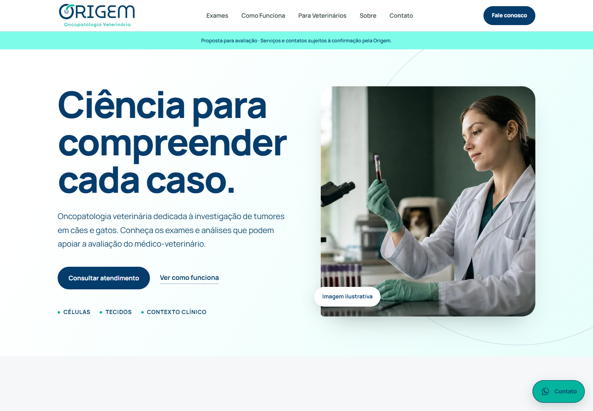
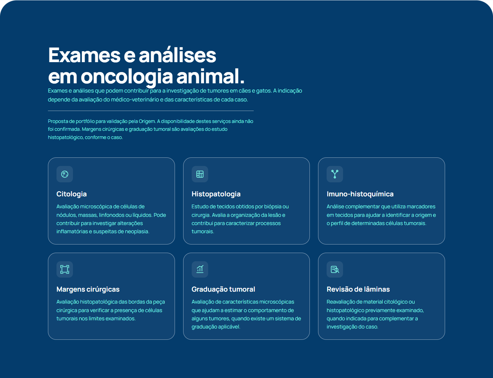
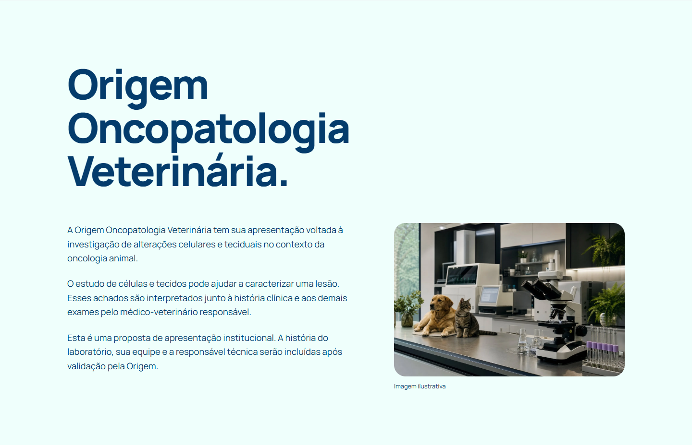

# Origem Oncopatologia Veterinária

Site institucional desenvolvido por **Victor Hugo Corrêa** para apresentar a Origem Oncopatologia Veterinária a médicos-veterinários, clínicas e hospitais veterinários.

O projeto combina identidade visual em verde e azul, layout responsivo e conteúdo sobre investigação oncológica em cães e gatos. Esta é a proposta visual v3; serviços, dados institucionais e canais de atendimento aguardam validação do laboratório.

**[Ver demonstração](https://origemoncopatologiav3.netlify.app/)** · **[Contato profissional](https://www.linkedin.com/in/victor-hn-correa)**



## Sobre o desenvolvimento

- Interface em HTML, CSS e JavaScript, sem frameworks ou dependências de execução.
- Layout adaptado para computador e celular, com menu de navegação móvel.
- Identidade visual aplicada com logotipo em SVG e imagens em WebP.
- Navegação por teclado, link para pular ao conteúdo e controle de foco no menu.
- Animações de entrada que respeitam a preferência do dispositivo por reduzir movimento.
- Botão de contato preparado para integrar o WhatsApp após confirmação do número oficial.

O trabalho abrange a implementação da interface, a adaptação responsiva e a aplicação da identidade fornecida. As imagens são ilustrativas e não representam fotografias verificadas das instalações ou da equipe.

## Prévia e conteúdo

A página reúne apresentação institucional, exames e análises, etapas de atendimento, informações para a rotina clínica, apresentação do laboratório e contato.

<details>
<summary>Ver outras capturas do projeto</summary>

### Exames



### Sobre o laboratório



[Ver captura completa no celular](screenshots/pagina-completa-celular.png)

</details>

## Tecnologias

HTML5, CSS3 e JavaScript. As fontes Manrope e Instrument Serif são carregadas pelo Google Fonts. A hospedagem de demonstração utiliza o Netlify.

## Executar localmente

Não há instalação de pacotes nem etapa de compilação. Com Git e Python 3 disponíveis:

```bash
git clone https://github.com/CorreaVictorHugo/origem-oncopatologia-site.git
cd origem-oncopatologia-site
python -m http.server 8000
```

Abra **[localhost:8000](http://localhost:8000)**. Também é possível usar um servidor estático de sua preferência ou abrir `index.html` diretamente. O carregamento das fontes externas exige conexão com a internet.

## Organização dos arquivos

```text
assets/          Imagens, logotipo e favicon usados na página
docs/            Orientações de manutenção e publicação
screenshots/     Capturas para apresentação do projeto
index.html       Conteúdo e estrutura semântica
styles.css       Estilos de base e componentes
origem.css       Ajustes de layout, acessibilidade e movimento
paleta.css       Paleta oficial e refinamentos visuais
origem.js        Menu, navegação, animações e configuração do contato
```

As folhas de estilo são carregadas na ordem `styles.css` → `origem.css` → `paleta.css`. Essa ordem preserva a composição visual atual.

## Estado da proposta

Os exames apresentados são sugestões de conteúdo e precisam ser confirmados pelo laboratório. O WhatsApp ainda não está configurado; o botão direciona à seção de contato. A página utiliza `noindex, nofollow` durante a avaliação.

Consulte as [orientações de manutenção e publicação](docs/MANUTENCAO.md) antes de preparar o lançamento oficial.

## Autoria e direitos de uso

Desenvolvimento por **Victor Hugo Corrêa**. Para conversar sobre um projeto, acesse meu **[LinkedIn](https://www.linkedin.com/in/victor-hn-correa)**.

A marca e os materiais institucionais pertencem aos respectivos titulares. A disponibilização deste repositório para apresentação de portfólio não concede licença de reutilização da identidade da Origem. Este projeto não declara uma licença de software livre.
